<div align="center">

<picture><source media="(prefers-color-scheme: dark)" srcset=".github/assets/hero-dark.svg"></picture>

</div>

Мой rice на CachyOS: Hyprland с конфигом на Lua, Caelestia/Quickshell, fish.
Раскладывается через GNU Stow — одна папка = один пакет, внутри повторяется структура `$HOME`.

## Установка

```sh
sudo pacman -S --needed stow git
git clone https://github.com/vladglass0/dotfiles ~/dotfiles
cd ~/dotfiles
stow */            # все пакеты
stow fish zsh      # или только нужные
stow -nv hypr      # dry-run: покажет конфликты
```

## Пакеты

| Пакет | Что внутри |
| --- | --- |
| `hypr` | Hyprland, конфиг на Lua (`hyprland.lua` + модули в `hyprland/`) |
| `caelestia` | shell, бар, лаунчер |
| `quickshell` | виджеты angelos |
| `kitty` | плюс `foot` и `alacritty` |
| `fish` | основной шелл |
| `zsh`, `bash` | запасные шеллы |
| `starship` | промпт |
| `fuzzel` | dmenu |
| `micro` | редактор |
| `btop`, `fastfetch` | монитор и fetch |
| `cava` | визуализатор + GLSL-шейдеры |

## Хоткеи

<picture><source media="(prefers-color-scheme: dark)" srcset=".github/assets/hotkeys-dark.svg"></picture>

Карточка собирается из [`variables.lua`](hypr/.config/hypr/variables.lua), там же полный список.

## Свой пакет

```sh
mkdir -p mypkg/.config/mypkg
stow mypkg       # прилинковать
stow -D mypkg    # отвязать, файлы останутся в репо
```

Не коммичу: `fish_variables`, `*.bak*`, бэкапы micro.

Основано на [caelestia-dots](https://github.com/caelestia-dots), [Hyprland](https://github.com/hyprwm/Hyprland), [Quickshell](https://quickshell.org), [CachyOS](https://cachyos.org), [GNU Stow](https://www.gnu.org/software/stow/).
