<div align="center">

<picture><source media="(prefers-color-scheme: dark)" srcset=".github/assets/hero-dark.svg"></picture>

<picture><source media="(prefers-color-scheme: dark)" srcset=".github/assets/packages-dark.svg"></picture>

<picture><source media="(prefers-color-scheme: dark)" srcset=".github/assets/wave-dark.svg"></picture>

</div>

## ⚡ Установка

```sh
sudo pacman -S stow git
git clone https://github.com/vladglass0/dotfiles ~/dotfiles
cd ~/dotfiles
stow */            # все пакеты
stow fish git zsh  # или только нужные
```

> [!TIP]
> `stow -nv <пакет>` делает dry-run: показывает, что будет слинковано и где есть конфликты.

## 🛠 Как это работает

Каждая папка — отдельный пакет, внутри которого повторяется структура `$HOME`:

```
dotfiles/fish/.config/fish  →  ~/.config/fish
dotfiles/zsh/.zshrc         →  ~/.zshrc
```

## ➕ Добавить / ➖ убрать

```sh
mkdir -p ~/dotfiles/<имя>/.config
mv ~/.config/<имя> ~/dotfiles/<имя>/.config/
cd ~/dotfiles && stow <имя>

stow -D <имя>      # удалит только симлинки, файлы останутся в репо
```

## 🙈 Не попадает в git

`fish_variables` · `*.bak*` · `micro/backups` · `micro/buffers`

<div align="center">

<picture><source media="(prefers-color-scheme: dark)" srcset=".github/assets/wave-dark.svg"></picture>

</div>
